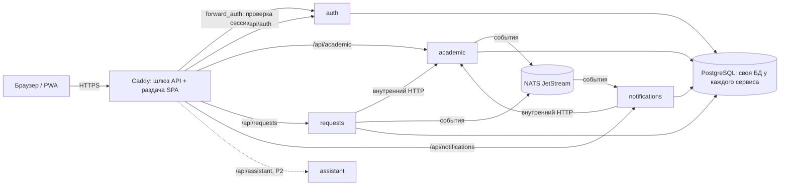

# Архитектура

Статус: этап 4, 2026-11-08. Решения D12, D22–D28 в [`decisions.md`](decisions.md). Безопасность и соответствие законам — [`security.md`](security.md).

## 1. Обзор

Микросервисы в одном монорепозитории с одним `go.mod`. При деплое это отдельные сервисы, при сборке — общая проверка типов компилятором: поломка стыка между сервисами не скомпилируется.



## 2. Сервисы

| Сервис | Отвечает за | Владеет данными | Публикует события | Вызывает |
|---|---|---|---|---|
| `auth` | Вход и выход, сессии, роли, защита от перебора паролей, проверка сессии для шлюза | users, sessions, login_attempts | — | — |
| `academic` | Профиль, факультеты, направления, академические и языковые группы, преподаватели (вымышленные), дисциплины, расписание с переносами, оценки и шкала МГИМО (D20), светофор (I2), выгрузка .ics (I4) | students, groups, teachers, disciplines, lessons, grades… | `academic.lesson.changed` | — |
| `requests` | Каталог услуг, заявки, история статусов, переписка (I3), вложения, PDF-справка с кодом проверки (I1) | service_types, applications, status_history, messages, attachments, certificates | `requests.application.status_changed`, `requests.application.message_added` | `academic` (данные студента для справки и для списка у сотрудника) |
| `notifications` | Лента уведомлений, объявления с подтверждением прочтения (I3), дедлайны и напоминания о них | notifications, announcements, announcement_reads, deadlines | — | `academic` (группа, курс и факультет получателя) |
| `assistant` (P2) | ИИ-помощник (I5); ключ LLM есть только у этого сервиса | справочник (FAQ) | — | LLM-API (GigaChat или YandexGPT) |

Отдельного сервиса-шлюза нет: эту роль играет Caddy. Отдельного сервиса для сотрудника тоже нет, это роль: её эндпоинты живут в `requests` и `notifications`.

**Напоминания о дедлайнах вычисляются при чтении ленты** (дедлайн в ближайшие N дней → элемент ленты), без планировщика. Фоновый воркер добавим, только если понадобятся push-уведомления.

## 3. Шлюз, вход и роли

1. Caddy принимает HTTPS, отдаёт SPA и маршрутизирует `/api/<сервис>/*`.
2. Caddy **удаляет** из входящего запроса любые заголовки `X-User-*`. Затем через `forward_auth` спрашивает у `auth` (`/internal/verify`), валидна ли сессия. В ответ `auth` отдаёт `X-User-Id`, `X-User-Role`, `X-Faculty-Id`, и Caddy передаёт их сервису.
3. Без проверки сессии доступны только: `POST /api/auth/login`, публичная проверка справки по коду, статика SPA, `/healthz`.
4. Сервисы слушают только внутреннюю сеть Docker. Заголовкам `X-User-*` они доверяют потому, что снаружи до них не достучаться. Публичный API — порт 8080, внутренний — **8081**; Caddy проксирует только 8080, поэтому `/internal/*` снаружи недоступен даже по подобранному адресу (D31).
5. Сервисы читают личность пользователя через общий middleware из `pkg/platform`.

| Роль | Что видит | Как это обеспечено в SQL |
|---|---|---|
| Студент | Только свои данные | Эндпоинты `/me/...` без ID студента в адресе; `WHERE student_id = <X-User-Id>` |
| Сотрудник деканата | Заявки, объявления и дедлайны своего факультета | `WHERE faculty_id = <X-Faculty-Id>` |
| Администратор | Всё | Без фильтра |

Чужой или несуществующий объект → **404** (не 403): так нельзя узнать, существует ли чужая заявка.

Сессия — случайный токен в cookie `HttpOnly; Secure; SameSite=Lax`, хранится в БД `auth`. Пароли — bcrypt.

## 4. Данные

- Один контейнер PostgreSQL. **У каждого сервиса своя база и свой пользователь БД** с правами только на неё: читать чужие таблицы невозможно физически.
- Миграции у каждого сервиса свои (goose), применяются при старте сервиса.
- Тестовые данные (вымышленные) — у каждого сервиса свой seed. Состав — этап 5.
- Факультет заявки фиксируется в момент подачи (берётся из `X-Faculty-Id`). Поэтому `requests` фильтрует заявки по факультету, не обращаясь к `academic`.

## 5. Контракты (стыки между частями)

| Стык | Где описан | Как проверяется |
|---|---|---|
| Публичный API сервиса | `docs/contracts/<сервис>.yaml` (OpenAPI 3.0.3) | Из него генерируются сервер (oapi-codegen, strict-server на `net/http`) и TS-клиент фронтенда (openapi-typescript + openapi-fetch). Хендлер не по контракту не компилируется |
| Внутренний API (порт 8081) | `docs/contracts/internal/<сервис>.yaml` | Генерируются сервер и клиент в `pkg/clients/<сервис>` |
| События | `docs/contracts/events.md` + Go-типы в `pkg/events` | Публикация и подписка только через типизированную обёртку, JSON руками не пишется |

Сгенерированный код не редактируется. CI проверяет, что после `make gen` в репозитории нет изменений. Контракт сервиса меняет только его владелец; правка чужого контракта согласуется с капитаном.

## 6. Структура репозитория

```
go.mod                      # один Go-модуль на все сервисы
services/
  auth/                     # эталонный сервис: остальные делаются по его образцу
    cmd/main.go
    internal/api/           # сгенерировано из контракта — не редактировать
    internal/db/            # сгенерировано sqlc — не редактировать
    internal/…              # хендлеры и бизнес-логика
    migrations/  queries/
  academic/  requests/  notifications/  assistant/   # та же структура
pkg/
  platform/                 # конфиг, логгер, БД, HTTP-сервер, middleware личности (X-User-*), ошибки
  events/                   # типы событий + обёртка NATS (Publish / Subscribe)
  clients/                  # сгенерированные клиенты внутренних API
frontend/
  src/api/                  # сгенерированные типы — не редактировать
  src/features/{today,schedule,grades,requests,notifications,profile,staff,admin}/
  src/shared/{ui,lib}/
e2e/                        # Playwright: сценарий жюри на 360 px
deploy/
  docker-compose.yml  Caddyfile  .env.example  postgres/init.sql
Dockerfile                  # один на все Go-сервисы (ARG SERVICE)
Makefile                    # gen, test, up, e2e, lint
docs/
```

## 7. Технологии

| Слой | Выбор |
|---|---|
| Бэкенд | Go 1.25, `net/http`, oapi-codegen v2, pgx v5, sqlc, goose, `log/slog`, bcrypt (`golang.org/x/crypto`) |
| События | NATS JetStream (`nats.go`) |
| PDF (I1) | Go-библиотека с поддержкой UTF-8 и встроенным шрифтом под лицензией OFL (конкретная — в ТЗ задачи) |
| Фронтенд | React + Vite + TypeScript, React Router, TanStack Query, openapi-fetch, Tailwind CSS, shadcn/ui (Radix), lucide-react, vite-plugin-pwa |
| Шрифты и иконки | Только с разрешающими лицензиями (OFL, MIT, ISC), **размещаются у нас** — никаких CDN и Google Fonts |
| Инфраструктура | Docker Compose, Caddy 2 (автоматический HTTPS), PostgreSQL 17, NATS 2 |
| Тесты и CI | `go test`, Playwright (e2e на 360 px), GitHub Actions: генерация совпадает с контрактом, тесты, `govulncheck`, `npm audit` |

Новые зависимости добавляются только при реальной необходимости и упоминаются в PR.

## 8. Масштабирование (закрывает Н6)

- Сервисы не хранят состояние: сессии в БД, события в JetStream. Любой сервис запускается в нескольких копиях (`docker compose up --scale academic=3`), Caddy распределяет нагрузку.
- Масштабируется только то, что нагружено. `academic` (расписание и оценки) — самый читаемый сервис; пики приходятся на начало семестра и сессию.
- Базы сервисов разделены. Любую можно перенести на отдельный сервер PostgreSQL, поменяв только строку подключения.
- Несколько копий `notifications` читают события как одна группа подписчиков JetStream: каждое событие обрабатывается один раз.
- Следующие шаги при реальном росте: кэш ответов расписания (ETag), реплики чтения PostgreSQL, вынос NATS и PostgreSQL на отдельные машины.

## 9. Эксплуатация

- У каждого сервиса `/healthz`; в compose — `healthcheck` и `restart: unless-stopped`.
- Логи — JSON в stdout со сквозным `X-Request-Id`. В логах только ID, никаких ФИО и других персональных данных.
- Ежедневный `pg_dump` на VPS: данные жюри должны сохраниться до 28.11.
- После сдачи (22.11) прод заморожен (Н10): выкладка только по тегу и только исправлений.

## 10. Почему микросервисы и как снижаем риски (D22)

Вариант выбран командой. Альтернатива — модульный монолит — рассматривалась на этапе 4. Риски и меры:

| Риск | Мера |
|---|---|
| Агенты разных людей по-разному реализуют стыки | Контракт на сервис + кодогенерация + один `go.mod` + проверка в CI |
| Четыре сервиса написаны в четырёх разных стилях | Эталонный сервис `auth` делает капитан первым; остальные копируют его структуру. Правила — в `AGENTS.md` |
| Проверку прав забыли в одном из сервисов | Личность проверяется один раз на шлюзе; общий middleware; e2e-тест «чужая заявка → 404» через шлюз |
| Инфраструктура съедает время на фичи | Фронтенд с первого дня работает на моках, сгенерированных из контрактов; поэтому контракты готовим до начала кода (этап 5) |
| Больше частей — больше способов упасть на проверке жюри | `healthcheck`, перезапуск, один `make up`, e2e-сценарий жюри в CI |
