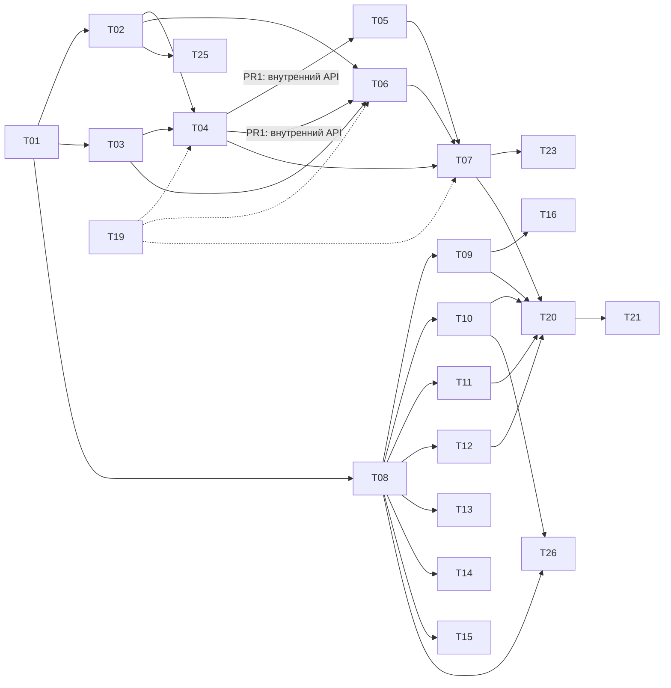

# План реализации

Статус: этап 7, 2026-11-08. Сдача — **22.11**, прод работает до **28.11**. Решения D43–D48.

## Принципы
- Сначала то, без чего балл не будет максимальным (**P0**), потом идеи (**P1**), потом ИИ-помощник (**P2**).
- **Самое критичное для безопасности и инфраструктура — у капитана** (`auth`, `requests`, шлюз, деплой). Участники ведут по одному сервису **вертикально — от БД до экрана**: Всеволод — `academic`, Владислав — `notifications` (D43).
- ТЗ участников написаны так, чтобы **приёмка шла по тестам с заранее заданными случаями**, а не по «вроде работает». Как работать с Codex — [`tasks/README.md`](tasks/README.md).
- План по **вехам**, а не по дням (D45). Одна задача = одна ветка = один PR. Без зелёного CI и ревью капитана в `main` ничего не попадает.

## Команда

| Кто | Инструмент | Зона |
|---|---|---|
| Капитан — Артём Лыткин | Claude Code (+ субагенты) | Инфраструктура, шлюз, `auth`, `pkg/events`, `requests`, каркас фронтенда, экраны заявок студента и сотрудника, деплой, ревью, сборка описания для жюри |
| Всеволод Омельченко | Codex | Сервис `academic` и его экраны (Сегодня, Расписание, Успеваемость, Профиль, перенос занятий у сотрудника), проверка справки, PWA и календарь, логотип, опрос студентов |
| Владислав Пилипенко | Codex | Сервис `notifications` и его экраны (Уведомления у студента, объявления и дедлайны у сотрудника), тексты через ИИ, e2e-сценарий жюри, аудит, видео, интерфейс ИИ-помощника (P2) |

## Вехи

| Веха | Дата | Что готово | Что это открывает |
|---|---|---|---|
| **M0** | 10.11 | T01 каркас и инфраструктура, T08 каркас фронтенда **с моками** | Фронтенд-задачи на моках |
| **M0.5** | 11.11 | T02 эталонный `auth` + `services/auth/README.md`, T03 события | Участники начинают сервисы T04, T06 |
| **M1** | 13.11 | Все сервисы в `main`. **T04 PR1** (внутренний API `academic`) — уже 12.11 | Проверка порядка урезания (D47) |
| **M2** | 16.11 | Тестовые данные, экраны ядра на настоящем API, стенд на VPS (T23) | e2e на настоящем бэкенде, аудит |
| **M3** | 18.11 | P1 влиты. **Заморозка функций**: дальше только исправления, дизайн, тексты | |
| **M4** | 21.11 | e2e зелёный на проде, чек-лист безопасности, видео, PDF | |
| Сдача | 22.11 | Отправка работы, **заморозка прода** (Н10) | Прод не трогаем до 28.11 |

До M0 участники делают задачи без кода: T18 опрос, T17 логотип (Всеволод), T19 тексты (Владислав).

## Задачи

| ID | Задача | Исполнитель | Приор. | Зависит от | Оценка |
|---|---|---|---|---|---|
| [T01](tasks/T01-skeleton-infra.md) | Каркас репозитория и инфраструктура | Капитан | P0 | — | 1–1,5 дня |
| [T02](tasks/T02-platform-auth.md) | `pkg/platform` и сервис `auth` (эталон) | Капитан | P0 | T01 | 1–1,5 дня |
| [T03](tasks/T03-events.md) | `pkg/events` | Капитан | P0 | T01 | 0,5 дня |
| [T04](tasks/T04-academic.md) | Сервис `academic` (+ его тестовые данные) | **Всеволод** | P0 | T02, T03 | 2–2,5 дня |
| [T05](tasks/T05-requests.md) | Сервис `requests` + PDF-справка (+ его тестовые данные) | Капитан (субагент) | P0 | T02, T03, T04 PR1 | 2 дня |
| [T06](tasks/T06-notifications.md) | Сервис `notifications` (+ его тестовые данные) | **Владислав** | P0 | T02, T03, T04 PR1 | 2 дня |
| [T07](tasks/T07-seed.md) | Тестовые данные: `auth`, сборка, пароли, сквозная проверка | Капитан | P0 | T04–T06 | 0,5 дня |
| [T08](tasks/T08-frontend-skeleton.md) | Каркас фронтенда: оболочка, вход, моки, общие состояния | Капитан | P0 | T01 | 1,5 дня |
| [T09](tasks/T09-student-academic-screens.md) | Экраны: Сегодня, Расписание, Успеваемость, Профиль | **Всеволод** | P0 | T08 | 2 дня |
| [T10](tasks/T10-student-requests.md) | Экраны студента: Заявки | Капитан | P0 | T08 | 1,5 дня |
| [T11](tasks/T11-student-notifications.md) | Экран студента: Уведомления и дедлайны | **Владислав** | P0 | T08 | 1 день |
| [T12](tasks/T12-staff-applications.md) | Кабинет сотрудника: заявки | Капитан | P0 | T08 | 1,5 дня |
| [T13](tasks/T13-staff-announcements.md) | Кабинет сотрудника: объявления и дедлайны | **Владислав** | P1 | T08 | 1,5 дня |
| [T14](tasks/T14-staff-lessons.md) | Кабинет сотрудника: перенос и отмена занятий | **Всеволод** | P1 | T08 | 1 день |
| [T15](tasks/T15-verify-page.md) | Страница проверки справки | **Всеволод** | P1 | T08 | 0,5 дня |
| [T16](tasks/T16-pwa-calendar.md) | PWA и выгрузка расписания в календарь | **Всеволод** | P1 | T09 | 0,5–1 день |
| [T17](tasks/T17-logo-illustrations.md) | Логотип, иконки, иллюстрации с ИИ | **Всеволод** | P1 | — (стиль согласуем) | 1 день |
| [T18](tasks/T18-student-survey.md) | Опрос студентов | **Всеволод** | P1 | — | 1 день (ответы — фоном) |
| [T19](tasks/T19-content.md) | Тексты через ИИ: новости, услуги, справочник, пустые состояния | **Владислав** | P1 | — | 1 день |
| [T20](tasks/T20-e2e.md) | e2e-сценарий жюри на 360 px + проверки доступа | **Владислав** | P0 | M2 | 1,5 дня |
| [T21](tasks/T21-a11y-mobile-audit.md) | Аудит доступности и мобильной версии | **Владислав** | P1 | M2 | 1 день |
| [T22](tasks/T22-video.md) | Видео-демонстрация до 5 минут | **Владислав** | P1 | M3 | 0,5 дня |
| [T23](tasks/T23-deploy.md) | Деплой на VPS, домен, HTTPS, резервные копии, чек-лист безопасности | Капитан | P0 | T01–T07 | 1 день |
| [T24](tasks/T24-process-description.md) | Описание процесса для жюри (PDF) | Капитан + все | P0 | все | 1 день |
| [T25](tasks/T25-assistant-service.md) | Сервис `assistant` | Капитан | P2 | T02; справочник T19 | 1 день |
| [T26](tasks/T26-assistant-ui.md) | Интерфейс ИИ-помощника | **Владислав** | P2 | T08, T10 | 1 день |

## Зависимости

## Карта экранов

| Адрес | Экран | Задача | Владелец |
|---|---|---|---|
| `/login` | Вход | T08 | Капитан |
| `/privacy` | Политика обработки ПДн | T08 | Капитан |
| `/` | Сегодня | T09 | Всеволод |
| `/schedule` | Расписание | T09 (+ кнопка календаря T16) | Всеволод |
| `/grades` | Успеваемость | T09 | Всеволод |
| `/profile` | Профиль | T09 | Всеволод |
| `/requests`, `/requests/new/:serviceTypeId`, `/requests/:id` | Заявки | T10 | Капитан |
| `/notifications` | Уведомления и дедлайны | T11 | Владислав |
| `/verify/:code` | Проверка справки (без входа) | T15 | Всеволод |
| `/staff`, `/staff/requests/:id` | Сотрудник: заявки | T12 | Капитан |
| `/staff/announcements`, `/staff/announcements/:id`, `/staff/deadlines` | Сотрудник: объявления и дедлайны | T13 | Владислав |
| `/staff/lessons` | Сотрудник: занятия | T14 | Всеволод |
| `/assistant` | ИИ-помощник (P2) | T26 | Владислав |

## Порядок урезания объёма (D47)

Если к вехам M1 или M2 отстаём, урезаем снизу вверх и **не трогаем P0**:
1. T25, T26 — ИИ-помощник.
2. T14 — перенос занятий сотрудником (изменения в расписании остаются в тестовых данных).
3. T13 — статистика «кто ознакомился» (подтверждение прочтения у студента остаётся).
4. T16 — PWA (выгрузка в календарь остаётся).
5. T21 — аудит сокращается до проверки 360 px.

Если участник застрял на сервисе дольше чем на день после срока, капитан забирает сервис субагенту. Уже написанные тесты из ТЗ остаются приёмкой.

## Чек-лист сдачи 22.11

- [ ] Прототип открывается по ссылке из России без VPN (проверить с мобильного интернета)
- [ ] Все 5 тестовых аккаунтов входят; логины и пароли — в комментарии к работе
- [ ] e2e-сценарий (T20) зелёный **на проде**
- [ ] Чек-лист безопасности `security.md` §6 пройден
- [ ] Дисклеймер, свой логотип, страница политики ПДн на месте
- [ ] Репозиторий: открыт или доступ жюри выдан (Н9)
- [ ] PDF-описание процесса (T24) по всем пунктам задания
- [ ] Видео (T22) загружено, ссылка рабочая
- [ ] Резервная копия БД снята; прод заморожен до 28.11

## Открытые пункты

| Что | Кто | До |
|---|---|---|
| Пригласить Всеволода и Владислава в GitHub | Капитан | сейчас |
| Купить VPS в РФ и домен | Капитан | M2 (T23) |
| Пароли тестовых аккаунтов (не в репозиторий) | Капитан | T07 |
| Регистрация в GigaChat или YandexGPT API | Капитан | M3, только если делаем P2 |
| ~~Дизайн: направление стиля~~ — решено: D52, `docs/design.md` | Капитан | ✅ 08.11 |

## На будущее

Не входит в вехи; делаем, когда появится время, но до заморозки функций (M3, 18.11), чтобы успеть проверить.

| Что | Зачем | Как | Когда и кто | Проверка |
|---|---|---|---|---|
| **Разбить бандл фронтенда по разделам** | Сейчас всё приложение — один файл (~584 КБ, 176 КБ в gzip): студент на телефоне при первом входе качает и кабинет сотрудника, и все разделы. После разбиения первый экран грузит только оболочку и свой раздел | В `features/*/routes.tsx` вместо `element: <Page />` — `lazy: () => import('./components/Page').then((m) => ({ Component: m.Page }))` (React Router 7). Оболочку, вход и общие компоненты оставить в основном файле. Пока раздел грузится — `LoadingState` | После того как T09, T11, T13, T14 влиты (иначе конфликты в файлах участников). Правки в чужих `routes.tsx` — по согласованию с владельцами (правило 26 в `AGENTS.md`) или их PR по короткому ТЗ от капитана | `npm run build`: основной файл заметно меньше, у разделов свои файлы; `vite build` без предупреждения о 500 КБ; e2e (T20) зелёный; на 3G в DevTools первый экран открывается быстрее, чем до правки |
