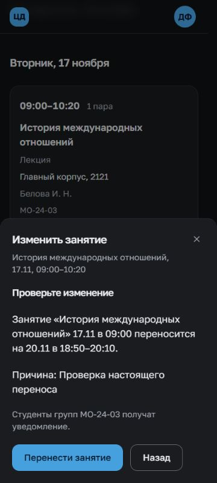
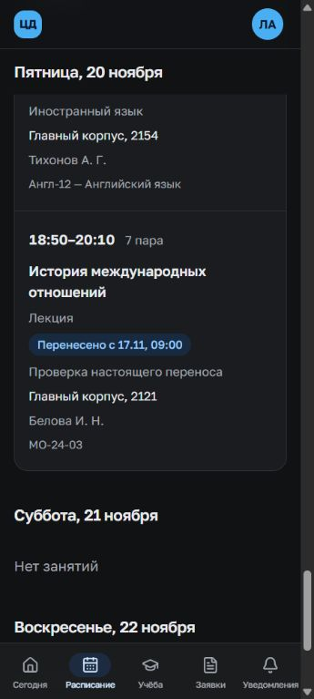

# Браузерная проверка на настоящем API, 09.11.2026

Проверены production-сборка интерфейса и настоящие `auth`, `academic`, `requests` через локальный Caddy. MSW не включался. Это дополнение к [HTTP-протоколу](../../runtime-api-check.md).

## Сборка и границы

- Бэкенд — `17b0af2`; фронтенд — T16 `db99d5e`, в отдельной временной копии добавлены `features/verify` и разрешённый обработчик requests из T15 `c625ce2`. Ветки и main не объединялись; рабочие копии участников не менялись. Мок-обработчик в production не используется.
- Встроенный браузер, локальный адрес `http://localhost:54173`. Настройки Secure/HttpOnly cookie в auth не менялись: браузеры допускают Secure cookie на localhost ([MDN](https://developer.mozilla.org/en-US/docs/Web/HTTP/Reference/Headers/Set-Cookie#secure)). HTTPS и сертификат отдельно проверены HTTP-клиентом; публичный домен этим не проверяется.
- Вход выполнялся через настоящую форму. Во временных auth-БД использован случайный пароль; для передачи в браузер он кратко находился в файле вне репозитория, после чтения файл сразу удалялся. После проверки выполнен logout, остановлены сервисы, удалены временные базы и CA.
- Viewport 360×800 и 1280×900. Из-за полосы прокрутки полезная ширина — 345/1265 px. В светлой теме для всех четырёх экранов измерено scrollWidth=clientWidth=345; фон rgb(244,246,250). В тёмной — графит rgb(17,18,20). Загружен Golos Text Variable. [Измерения светлой темы](appearance-measurements.json).
- Полные снимки длинных мобильных страниц показывают фиксированную панель на позиции исходного viewport; во время обычной прокрутки она остаётся внизу экрана. `student-after-transfer` и подтверждение переноса — снимки одного viewport.

## Четыре экрана студента

| Экран | 360 px, светлая | 360 px, тёмная | 1280 px, тёмная |
|---|---|---|---|
| Сегодня | [Снимок](today-360-light.jpg) | [Снимок](today-360-dark.jpg) | [Снимок](today-1280-dark.jpg) |
| Расписание 16–22.11 | [Снимок](schedule-360-light.jpg) | [Снимок](schedule-360-dark.jpg) | [Снимок](schedule-1280-dark.jpg) |
| Успеваемость | [Снимок](grades-360-light.jpg) | [Снимок](grades-360-dark.jpg) | [Снимок](grades-1280-dark.jpg) |
| Профиль | [Снимок](profile-360-light.jpg) | [Снимок](profile-360-dark.jpg) | [Снимок](profile-1280-dark.jpg) |

Расписание показывает настоящий seed: исходный и новый слот переноса, отмену с причиной, другую аудиторию, академическую и языковые группы. В успеваемости — 3/2/1 по рискам, реальные контрольные баллы и [сессии](sessions-360-dark.jpg); у зачёта нет ECTS. Профиль показывает год поступления 2025, курс 2 и группу МО-24-03.

**Ограничение главной:** `notifications` пока не реализован. Счётчик и дедлайны получают ошибку, которая видна на снимках. При этом расписание, изменения, профиль и заявки продолжают работать. Полный успешный экран с настоящими дедлайнами и счётчиком не объявляется проверенным.

При выходе из студенческой сессии выбранная тёмная тема осталась на экране входа. После проверки настройки возвращены в «Как в системе», viewport восстановлен.

## Сотрудник → настоящий API → студент

Вход `dekanat.mo`; в общем Select выбрана МО-24-03, кнопкой выбрана неделя 16–22.11. Группа и дата присутствуют в URL. [Список сотрудника на компьютере](staff-1280-dark.jpg).

На 360 px через Sheet перенесено занятие «История международных отношений»: **17.11 09:00 → 20.11 18:50–20:10**. Выбрана 7-я пара, введена причина, проверена сводка и нажата именно «Перенести занятие». Настоящий API сохранил изменение, Sheet закрылся, появился тост «Занятие перенесено».

После выхода сотрудника и нового входа `student.mo` в расписании видны новый слот и метка «Перенесено с 17.11, 09:00»:

Подписчик `pkg/events` получил одно настоящее событие от этого действия интерфейса: [runtime-ui-events.json](../../runtime-ui-events.json). previous — 17.11 09:00, current — 20.11 18:50. Доставка уведомления на экран остаётся открытой до T06.

Неудачный шаг также сохранён: [пустая дата после ввода инструментом](transfer-date-empty-tool-360-dark.jpg). Проверка формы не отправила запрос. После ввода даты штатными клавишами она появилась в сводке; подтверждённый перенос выполнен только затем. Это не снимок успешного подтверждения.

## Публичная проверка справки

После logout открыта настоящая `requests`-справка K7M2QX4PWA без сессии: «Справка действительна», инициалы, факультет и даты, без студенческого меню. [360 px](verify-valid-360-dark.jpg), [1280 px](verify-valid-1280-dark.jpg).

Через «Проверить другой код» введён AAAAAAAAAA, отправлена форма. Настоящий 404 показывает [«Справка с таким кодом не найдена»](verify-not-found-360-dark.jpg). Истёкшая справка и 429 подтверждены отдельной HTTP-проверкой; их браузерные снимки в этот комплект не входят.

## Скачивание календаря

Кнопка «Скачать для календаря» действительно скачала файл из academic, от сегодняшней даты до конца семестра: [runtime-calendar.ics](../../runtime-calendar.ics). Независимый ICAL.js разобрал **137 событий**, уникальные UID, Europe/Moscow, длительности 80 минут; первая дата 09.11, последняя 25.12. [Результат и SHA-256](../../runtime-calendar-validation.json).

Файл скачан **до** ручного переноса 17→20 в этом запуске. Это сохранённый снимок расписания, а не подписка. Новый импорт этих 137 событий в Google Calendar или телефон не выполнялся. Проверки Manifest/установки PWA, DevTools, Cache Storage и настоящего iPhone остаются открытыми.

Светлая тема проверена отдельным повтором с чистыми временными БД; она показывает исходный seed, а не состояние после переноса первого запуска. Системная тема браузера тёмная, поэтому светлая была выбрана явно. Первоначальные имена файлов исправлены по фактической палитре до публикации.

## Последующая приёмка T16, 09.11.2026

Фраза «импорт не выполнялся» выше относится к моменту первоначального запуска. После него **тот же файл** с SHA-256 `db251e059e8e50928144b42f65d5991e3935135eba681a902c7dc314a4ad05b9` импортирован в отдельный Google-календарь: 137 из 137 событий. Участник подтвердил их отображение на Android, после чего временный календарь удалён с отдельным согласием. В Chrome на Windows также подтверждена установка PWA; появился отдельный экземпляр приложения. Снимки телефона и установленного окна пока отсутствуют, Manifest и Cache Storage требуют ручной приёмки.

[Подробный протокол и снимок успешного импорта](https://github.com/4RH1T3CT0R7/mgimo-digital-dean/blob/96421a0a4d31d4cb4bcc2c2af895cb5eebcf3962/docs/process/screenshots/t16/README.md). Это уточнение статуса, исходные байты `.ics` и результаты первоначального запуска не изменялись.
