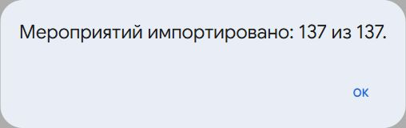

# T16: установка и импорт календаря, 09.11.2026

Проверял Всеволод Омельченко с Codex. Production-фронтенд — `db99d5e0484e39a9e199124165917bf0400ae026`, реальные локальные API `auth`, `academic`, `requests` за шлюзом, только вымышленные seed-данные.

## Установка

В обычном Chrome на Windows кнопка «Установить приложение» в профиле вызвала системное приглашение. Участник нажал «Установить» и подтвердил результат; после этого обнаружено отдельное окно «Цифровой деканат — концепт». Это не проверка установки на Android. Снимок установленного окна не получен. При попытке прочитать открытый участником DevTools → Application → Manifest управление Windows остановилось: инструмент не смог надёжно определить адрес окна. Проверка Manifest без ошибок и проверка Cache Storage после выхода остаются открытыми.

## Импорт и Android

Использован файл `mgimo-schedule.ics`, скачанный настоящей кнопкой расписания из academic до ручного переноса в предыдущей проверке UI:

- 43 539 байт, 137 уникальных событий; зона Europe/Moscow, период 09.11–25.12.2026.
- SHA-256: `db251e059e8e50928144b42f65d5991e3935135eba681a902c7dc314a4ad05b9`.
- [Исходные байты с сохранёнными CRLF](https://github.com/4RH1T3CT0R7/mgimo-digital-dean/blob/a985e7d391f802e1da180462d9f748e988379ac5/docs/process/runtime-calendar.ics); [протокол скачивания и независимого разбора ICAL.js](https://github.com/4RH1T3CT0R7/mgimo-digital-dean/blob/a985e7d391f802e1da180462d9f748e988379ac5/docs/process/screenshots/runtime-api/README.md).

С отдельного разрешения участника создан временный календарь «Тест T16 — расписание», часовой пояс Москва. Файл импортирован именно в этот календарь. Google показал «Мероприятий импортировано: 137 из 137».

Участник открыл Google Календарь на Android под тем же аккаунтом, включил временный календарь и на вопрос о занятиях за 16–20 ноября 2026 года ответил **«Да, занятия видны»**. Проверен путь через веб-импорт и синхронизацию Google Calendar. Прямое открытие `.ics` на Android не проверялось. Снимок экрана телефона не предоставлен, поэтому обязательный критерий ТЗ со скриншотом ещё не закрыт.

## Завершение теста

После проверки Android участник отдельно подтвердил необратимое удаление временного календаря. Удалён только «Тест T16 — расписание»: Google показал «Календарь удален», его строка исчезла из настроек. Основной и другие календари не изменялись. В репозиторий включён только снимок результата импорта без имени аккаунта и адреса почты.

T16 остаётся черновиком: нужны снимки Manifest, установленного приложения, Cache Storage после просмотра расписания и выхода, а также календаря телефона. iPhone и safe-area на настоящем iPhone отдельно не проверены.
