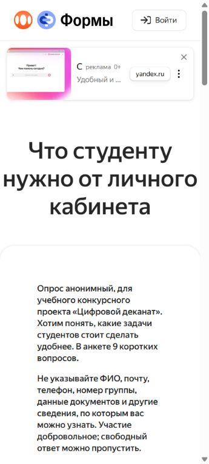

# T18. Опрос студентов

**Исполнитель:** Всеволод Омельченко. **Обновлено:** 09.11.2026.

## Состояние

Анкета создана и опубликована **09.11.2026**: [Что студенту нужно от личного кабинета](https://forms.yandex.ru/u/6af1aef56d2d730da9e02707/).

При завершении проверки в интерфейсе Яндекс Форм — **0 ответов**. Тестовые ответы не отправлялись; выводы по студентам пока не сформированы.

Сбор ответов — до **13.11**, итоги — до **14.11**. Цель — не менее 15 настоящих ответов. Если ответов окажется меньше, здесь будет указано фактическое число.

## Готовый текст анкеты

**Название:** Что студенту нужно от личного кабинета

**Описание:** Опрос анонимный, для учебного конкурсного проекта «Цифровой деканат». Хотим понять, какие задачи студентов стоит сделать удобнее. В анкете 9 коротких вопросов. Не указывайте ФИО, почту, телефон, номер группы, данные документов и другие сведения, по которым вас можно узнать. Участие добровольное; свободный ответ можно пропустить.

### 1. На каком курсе вы учитесь?

Один вариант, обязательный: 1; 2; 3; 4; 5; 6; другое.

### 2. К какому направлению относится ваше обучение?

Один вариант, обязательный: гуманитарное; экономическое; юридическое; техническое; другое.

### 3. Где вы сейчас смотрите расписание, оценки и объявления деканата?

Несколько вариантов, обязательный:

- В личном кабинете на сайте вуза.
- В приложении вуза.
- На сайте факультета или кафедры.
- В учебной системе или электронном журнале.
- В студенческих чатах и сообщениях.
- Узнаю лично у однокурсников или в деканате.
- Другое (можно уточнить в последнем вопросе).

### 4. Какие сложности в общении с деканатом мешают вам больше всего?

До 3 вариантов, обязательный. Если сложностей нет, выберите только «Существенных сложностей нет».

- Очереди за справками.
- Не знаю статус своего заявления.
- Узнаю о переносах пар в последний момент.
- Объявления теряются в чатах.
- Непонятно, как у меня дела с учёбой.
- Неудобно пользоваться сервисами с телефона.
- Другое (можно уточнить в последнем вопросе).
- Существенных сложностей нет.

### 5. Как часто вам нужна справка с места учёбы?

Один вариант, обязательный: ни разу не требовалась; 1–2 раза в год; несколько раз в семестр; чаще.

### 6. Что вы хотели бы видеть на главном экране кабинета?

Несколько вариантов, обязательный: ближайшая пара; изменения в расписании; дедлайны; статусы заявлений; оценки; новости; другое (можно уточнить в последнем вопросе).

### 7. С какого устройства вы бы чаще пользовались кабинетом?

Один вариант, обязательный: телефон; компьютер; одинаково с телефона и компьютера.

### 8. Пользовались бы вы ИИ-помощником, который отвечает на вопросы о правилах вуза и помогает заполнить заявление?

Один вариант, обязательный: да; скорее да; скорее нет; нет.

### 9. Чего вам не хватает в нынешних сервисах вуза?

Свободный ответ, необязательный, до 1000 символов. Подсказка: «Можно пропустить. Здесь можно уточнить вариант „Другое“. Не указывайте личные данные и имена других людей».

**Сообщение после отправки:** Спасибо! Ваш ответ поможет выбрать, что улучшить в учебном прототипе.

## Настройки и выполненная проверка

- Открытый доступ по ссылке без входа в Яндекс; не требовать авторизацию для ограничения повторов.
- Не добавлять поля ФИО, email, телефона, номера группы или названия вуза. Не включать сбор адреса аккаунта респондента.
- Не публиковать индивидуальные ответы. Свободный ответ оставить необязательным.
- В вопросе 4 настроить максимум 3 варианта. В предпросмотре проверить, что четвёртый выбор не принимается.
- Проверить мобильный вид и открытие формы без сессии. Тестовые ответы не добавлять в основную выборку.
- Форма открыта в Chrome без авторизации: видны все вопросы и ссылка «Войти», вход не требуется.
- После перезагрузки проверены сохранённые вопросы и варианты; в предпросмотре после трёх выбранных проблем четвёртый вариант становится недоступен. Выбор затем сброшен, кнопка отправки не нажималась.
- На 360×800 после загрузки страницы нет горизонтального переполнения (ширина документа 345 px); сохранён также полный снимок для компьютера. Временная настройка viewport восстановлена.

[Полный снимок анкеты для компьютера](screenshots/T18-survey-desktop.jpg)

## Текст приглашения для самостоятельного распространения

«Делаем учебный проект личного кабинета студента и хотим понять, какие задачи сейчас неудобны. Помогите коротким анонимным опросом: https://forms.yandex.ru/u/6af1aef56d2d730da9e02707/ . ФИО, почту и группу не спрашиваем. Ответить можно до 13 ноября. Спасибо!»

Приглашения от имени пользователя не отправлялись. Распространение среди однокурсников и знакомых остаётся за участником; реальные ответы нельзя заменить сгенерированными.

## Как подвести итоги

Сохранить фактические даты сбора и число ответов. Проверить экспорт перед включением в репозиторий: не сохранять идентификаторы ответов, технические метаданные и личные сведения из свободного текста. Для отчёта использовать агрегаты и обезличенные формулировки.

- Для каждого варианта: число выбравших / число ответивших на этот вопрос × 100%, округление до одного знака. Показывать также исходные количества.
- В вопросах с несколькими вариантами сумма процентов может превышать 100%. Пропуски необязательного вопроса учитывать отдельно.
- Если «Существенных сложностей нет» выбрано вместе с проблемами, отметить ответ на вопрос 4 как неоднозначный и отдельно указать его исключение из расчёта этого вопроса; остальные ответы респондента сохранить.
- Свести курсы и направления в отдельные таблицы. Это добровольная выборка знакомых, её нельзя объявлять репрезентативной для всех студентов.
- Сформулировать 3–5 выводов только по полученным ответам. Различать решения, принятые до опроса, и изменения, которые команда одобрила после него.

| Что узнали из ответов | Число / база / доля | Как это связано с кабинетом | Статус решения |
|---|---|---|---|
| Заполняется после сбора | — | Главная «Сегодня», расписание, заявки, мобильная версия или другое | Уже было в проекте / предложено команде / одобрено командой |

Таблицы частот, снимки диаграмм и выводы пока не заполнены: данных нет. Если для обобщения свободных ответов будет использован ИИ, сюда будут добавлены инструмент и точный промпт; в ИИ не передаются личные сведения.

## Приёмка T18

- [x] Текст анонимной анкеты и варианты ответов подготовлены.
- [x] Анкета создана и проверена в Яндекс Формах, ссылка и снимки добавлены.
- [ ] Собраны 15+ реальных ответов или честно указано меньшее фактическое число.
- [ ] Добавлены распределения, 3–5 выводов и таблица связи с продуктом.
- [x] В этом файле нет персональных данных респондентов.

## Повторная проверка и замечание капитана, 09.11.2026

Список личных форм показал **«Опубликована» / «Нет ответов»**, в конструкторе — **«Ответы 0»**. [Снимок счётчика](screenshots/T18-zero-responses-2026-11-09.jpg). Настоящих данных для долей, диаграмм и выводов пока нет; ответы не отправлялись от имени участника и не генерировались.

По замечанию капитана вступление сокращено: вместо перечисления личных сведений теперь **«Не указывайте личные данные»**. Предупреждение в необязательном вопросе 9 сохранено. Актуальное описание:

> Опрос анонимный, для учебного конкурсного проекта «Цифровой деканат». Хотим понять, какие задачи студентов стоит сделать удобнее. В анкете 9 коротких вопросов. Не указывайте личные данные. Участие добровольное; свободный ответ можно пропустить.

Правка проверена после перезагрузки конструктора и в опубликованной форме. [Снимок опубликованного вступления](screenshots/T18-short-description.jpg). Эта запись уточняет первоначальный текст описания выше; состав вопросов и правила обработки ответов не менялись.

Сбор продолжается до 13.11, итоги — до 14.11. Распространение ссылки среди настоящих студентов остаётся за участником: поручения писать другим людям не было.
